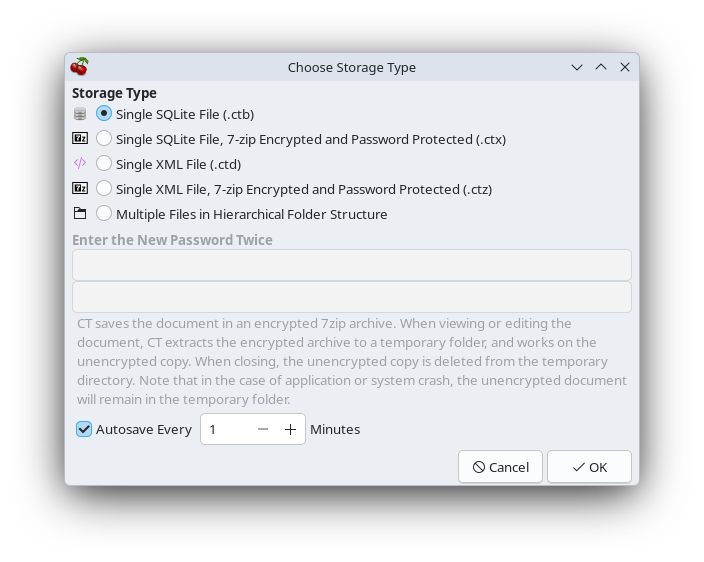
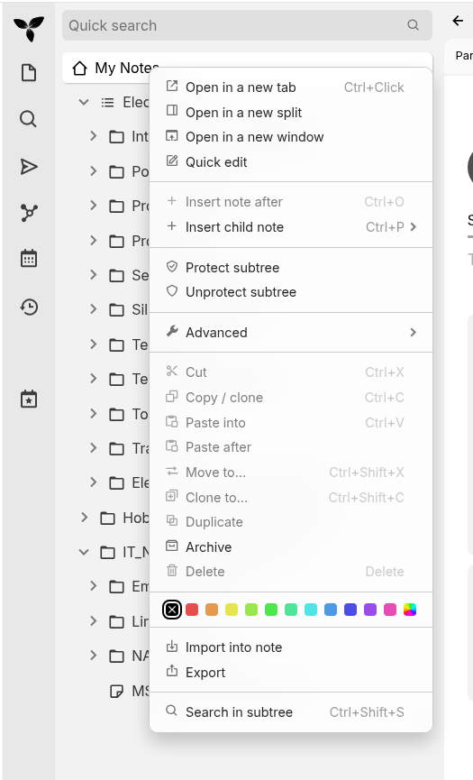
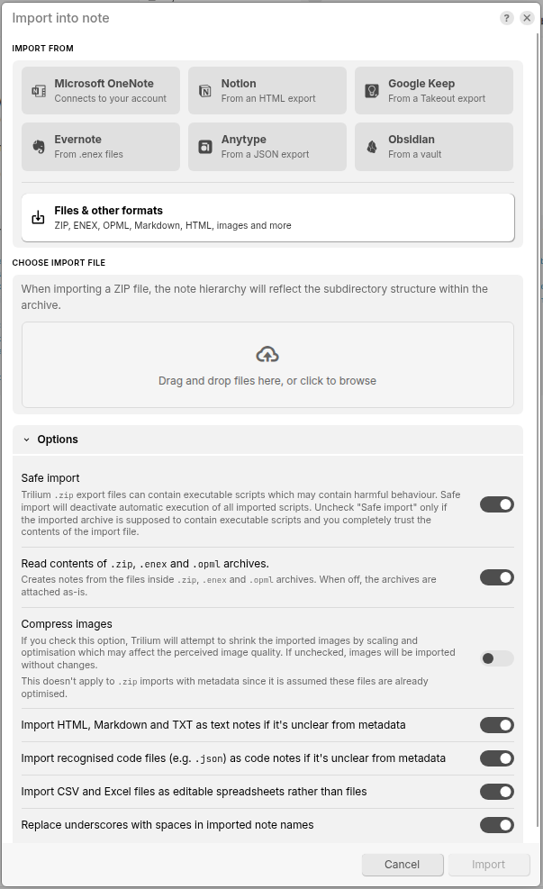

# CherryTree to Trilium Converter

This Python script converts a CherryTree note tree to a format that can be directly imported into Trilium. It preserves the hierachy and images, attached files and the formatting inside notes.

## How to Use

First, export your CherryTree notes as follows:

1. Open your notes in CherryTree.

2. In CherryTree, select ***File*** then ***Save As***. The window below will appear.

   

3. Make sure you select the ***Single SQLite File (.ctb)*** option, then Click ***OK***.

4. Select a location and name for the file, then click ***Save***.

Now, open a command window and use the following syntax to convert the file to one that Trilium can understand:

```
python3 cherrytree2trilium.py CherryTreeNotesFile.ctb [-o out.zip]
```

where:

- *CherryTreeNotesFile.ctb* is the file you saved from CherryTree in the steps above.

- *-o out.zip* is an optional parameter that specifies an output file name. If you don't enter this, the output file will have the same name as the input file (with a .zip extension) and be placed in the directory you're currently working in.

Finally, import into Trilium:

1. Right-click on the Note you want to import into, then select the ***Import into Note*** option:

    

2. A large (and rather complicated) dialog will appear, as below. Don't panic, the selections are simple!

   

3. ***Make sure you turn off the Compress Images option***, unless you really want it. It will degrade the appearance of nay images you have in notes!

4. Simply select the big ***Drag and drop files here, or click to browse*** button and select the .zip file you created with the converter script, or drag and drop it if that's your thing!

The notes should import as a tree under the note you selected. That simple!

## Disclaimer!

I created this, with a lot of AI help, for my own purposes. It migrated my very large CherryTree note sets very quikly and with no errors or issies that I've noticed yet, *however* I cannot promise it will do the same for you. I assume you know what you're doing.

***Use at your own risk***

## How things come across

1. Images become attachments shown in place in the text.

2. Embedded PDFs and zips become attachments with a 📎 link where they sat in the note.

3. Formatting: headings, bold, italic, underline, strikethrough, monospace, and links all carry over.

4. Bullets, numbered items and CherryTree to-do checkboxes become real Trilium lists.

5. Tables become Trilium tables with the correct header row.

6. Code boxes become code blocks with syntax highlighting.

7. Code nodes become Trilium code notes.

8. Links between CherryTree nodes become working Trilium note links.

9. Tags become labels, and read-only nodes stay read-only.

## Things that change:

1. Text colours: near-black and grey text colours that came in with web pastes (like #414042). Trilium was flagging them as highlights, and dark grey text would be hard to read in a dark theme. Real colours such as red are kept.

2. Duplicate headings: if a note started with a heading repeating its own name, it's removed as Trilium already shows the title of a note.

3. Email links (mailto:) become plain text. Trilium’s importer otherwise turns them into broken note links.

4. Dates: created and modified dates will be the import date, as the ZIP format doesn’t carry CherryTree’s timestamps.

5. Large notes open as “Auto read-only” in Trilium. That’s Trilium’s normal behaviour for long notes; click the badge to edit.

## Errors

If you put Trilium behind the Synology reverse proxy and the import fails with an “entity too large” (HTTP 413) error, the proxy’s upload size limit is too small for the ZIP. Importing directly on the container’s port avoids it.
